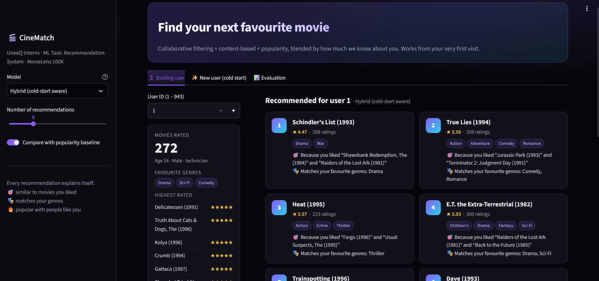
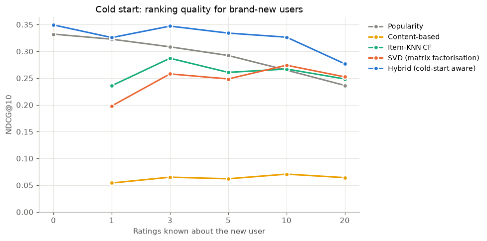

# Movie Recommendation System

A movie recommender I built for the UneeQ Interns machine learning internship. It suggests movies for existing users and for brand-new users with no history, compares several approaches against a popularity baseline, and explains each recommendation.



## What it does

- **Popularity baseline:** the most-rated movies. This is the bar the other models have to beat.
- **Content-based filtering:** recommends movies with similar genres and release era.
- **Collaborative filtering:** item-to-item similarity (Item-KNN) and matrix factorization (SVD).
- **Hybrid model:**
  - It leans on popularity and the user's chosen genres when we know little about them, then shifts to collaborative filtering as they rate more movies. This is how it handles cold start.
  - It also uses age group and gender: with zero ratings, its starting point is what's popular with people of the same age group and gender.
- **Explanations:** every recommendation says why it was picked, for example "Because you liked Shawshank Redemption and Back to the Future".
- **Streamlit demo:** with views for existing users, new users, and the evaluation results.

## Results

Evaluated on MovieLens 100K with a time-based split: each user's newest 20% of ratings are hidden, and a hidden movie rated 4 or 5 stars counts as relevant.

| Model | NDCG@10 | Recall@10 | Hit rate@10 | Catalogue coverage |
|---|---|---|---|---|
| Popularity (baseline) | 0.099 | 0.084 | 0.444 | 4% |
| Content-based | 0.023 | 0.015 | 0.148 | 65% |
| Item-KNN | 0.167 | 0.141 | 0.574 | 27% |
| SVD | 0.173 | 0.161 | 0.617 | 30% |
| **Hybrid** | **0.182** | **0.161** | 0.610 | 27% |

**Existing users:** the hybrid improves NDCG by about 84% over the baseline and recommends far more of the catalogue.

**New users:** I removed 20% of users from training and revealed only their first few ratings. The hybrid was the best model at every step (0, 1, 3, 5, 10 and 20 known ratings).

**Tuning:** the hybrid's settings were tuned on a separate validation group, so the test numbers weren't used for any decision.



More detail is in the [evaluation report](reports/evaluation_report.md) and the [notebook](notebooks/recommendation_system.ipynb).

## Run it

Python 3.10+. The MovieLens data downloads automatically on the first run.

```bash
git clone https://github.com/habibaashraf7/movie-recommendation-system.git
cd movie-recommendation-system
pip install -r requirements.txt
streamlit run app.py
```

To reproduce the numbers:

```bash
python -m src.tune       # optional: re-tune the hybrid on validation data
python -m src.evaluate   # writes reports/results_*.csv
```

## Project structure

```
app.py                 Streamlit demo
src/data.py            loading and time-based split
src/models.py          popularity, content, Item-KNN, SVD, hybrid
src/evaluate.py        ranking metrics and evaluation
src/tune.py            hybrid tuning on validation data
src/service.py         small Python API used by the app
notebooks/             analysis notebook
reports/               evaluation report, results, figures
```

## Limitations

* It's evaluated offline only.
* MovieLens 100K is small and from 1998.
* Popularity bias in the data favours well-known movies.

Next steps:
* Text features from plot descriptions.
* Implicit-feedback models (ALS/BPR).
* Diversity-aware re-ranking.

## Data

MovieLens 100K, from [GroupLens](https://grouplens.org/datasets/movielens/100k/) (Harper & Konstan, 2015).
