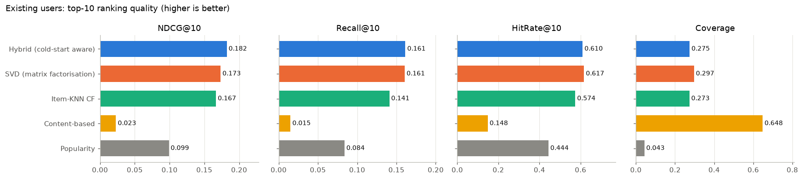
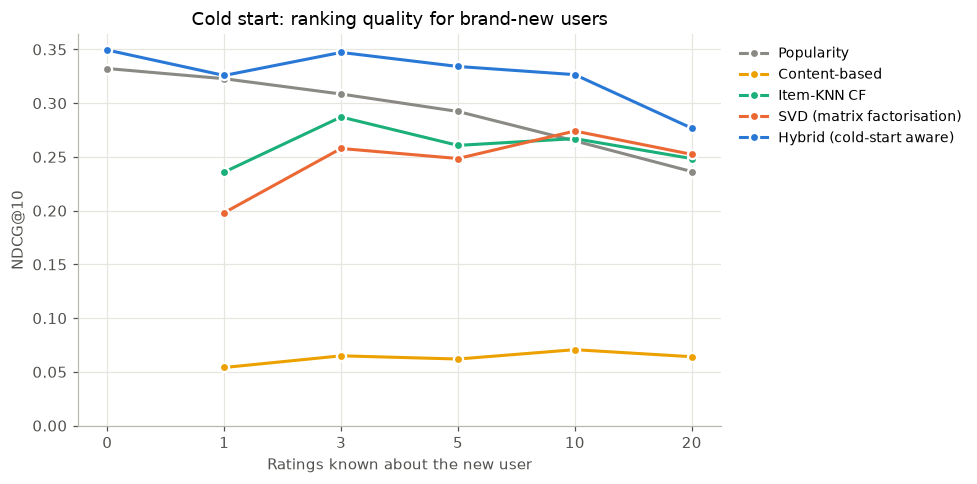

# Evaluation Report — Movie Recommendation System

**Task:** UneeQ Interns · Machine Learning track · *ML Task: Recommendation System*
**Dataset:** MovieLens 100K — 100,000 ratings (1–5★), 943 users, 1,682 movies, 19 genres, user age/gender/occupation.

---

## 1. Summary

| | Result |
|---|---|
| Best model | **Hybrid (cold-start aware)**: SVD collaborative filtering + content-based genres + demographic popularity |
| Existing users | NDCG@10 **0.182** vs **0.099** for the popularity baseline (**+84%**); catalogue coverage 27% vs 4% |
| New users | Best NDCG@10 at every stage (0, 1, 3, 5, 10, 20 known ratings); at 0 ratings it uses age group, gender and sign-up genres |
| Explainability | Every recommendation has a reason: *"Because you liked X and Y"*, *"Matches your favourite genres: …"*, *"Popular with M, age 25-34 viewers"* |

## 2. Evaluation protocol

**Split (no leakage).**

* **Existing users (80% of users):** each user's ratings are sorted by time. The oldest 80% are used for training and the newest 20% for testing. This simulates predicting what a user will watch *next*, which is harder and more realistic than hiding random ratings.
* **Simulated new users (20% of users, 188 users):** removed from training entirely. They are split into two halves:
  * **94 tuning users,** used only to choose the hybrid's settings.
  * **94 test users,** used only for the numbers in this report.
* For each new user we reveal only their first *n* ratings (*n* = 0, 1, 3, 5, 10, 20) and rank everything else. With *n* = 0 we know only the sign-up info (age group, gender).

**Relevance.** A held-out movie is *relevant* if the user rated it **≥ 4★**. Each model returns a top-10 list of movies the user has not rated yet.

**Metrics (all @10, averaged over users).**

| Metric | Question it answers |
|---|---|
| Precision@10 | What share of the 10 recommendations were relevant? |
| Recall@10 | What share of the user's relevant movies did we find? |
| NDCG@10 | Are relevant movies ranked near the **top**? (main metric) |
| MAP@10 | Average precision at each relevant hit, rewarding early hits |
| HitRate@10 | Did the list contain at least one relevant movie? |
| Coverage | What share of the whole catalogue gets recommended to anyone? (diversity) |
| Novelty | Mean −log₂(popularity) of recommended movies (higher = less mainstream) |

## 3. Models

| Model | How it works | Explanation |
|---|---|---|
| **Popularity** (baseline) | Movies ranked by number of ratings; same list for everyone | "Popular: rated by N users" |
| **Content-based** | Item vector = IDF-weighted genres + release decade. User vector = Σ (rating − 3) · item vector, plus genres picked at sign-up | "Matches your favourite genres" |
| **Item-KNN CF** | Cosine similarity between movies from co-ratings (top-50 neighbours, shrinkage 10). Score = Σ (rating − 2.5) · similarity | "Because you liked X and Y" |
| **SVD** | PureSVD with 50 latent factors. Any profile is folded in as x·Vᵀ·V, with no retraining for new users | nearest liked movies |
| **Hybrid** | `a·CF + (1−a)·(b·content + (1−b)·demographic popularity)`, then blended with a 10% popularity prior; `a = n/(n+n0)` grows with the number of ratings *n* | combination of the above |

**Hybrid tuning.** A grid of 280 settings was searched: CF ∈ {Item-KNN, SVD}, n0 ∈ {1…100}, content weight ∈ {0…0.5} and popularity floor ∈ {0…0.5}.

* **Validation data:** the newest 10% of existing users' *training* ratings, plus the 94 tuning users.
* **Objective:** ½ NDCG (existing users) + ½ mean NDCG (new users).
* **Selected:** SVD, n0 = 5, content weight 0.3, popularity floor 0.1.
* **Stability:** the top 5 settings score within 0.002 of each other, so the result does not depend on a lucky setting.

## 4. Results — existing users (test set, 728 users)

| Model | Precision@10 | Recall@10 | NDCG@10 | MAP@10 | HitRate@10 | Coverage | Novelty |
|---|---|---|---|---|---|---|---|
| Popularity (baseline) | 0.077 | 0.084 | 0.099 | 0.047 | 0.444 | 0.043 | 7.75 |
| Content-based | 0.018 | 0.015 | 0.023 | 0.009 | 0.148 | 0.648 | 12.04 |
| Item-KNN CF | 0.123 | 0.141 | 0.167 | 0.091 | 0.574 | 0.274 | 8.68 |
| SVD | 0.123 | 0.161 | 0.173 | 0.091 | **0.617** | 0.297 | 8.82 |
| **Hybrid** | **0.126** | **0.161** | **0.182** | **0.100** | 0.610 | 0.275 | 8.60 |



* All collaborative models clearly beat the baseline, by +68% to +84% NDCG@10.
* They also recommend 6–7× more of the catalogue than popularity, so users are not all shown the same blockbusters.
* Content-based alone ranks poorly: genres are too coarse ("Drama" covers 725 movies). It has the highest coverage and novelty, and it is useful for explanations and new users.

## 5. Results — cold start (94 unseen test users)

NDCG@10 by the number of ratings known about the new user:

| Known ratings | 0 | 1 | 3 | 5 | 10 | 20 |
|---|---|---|---|---|---|---|
| Popularity | 0.332 | 0.323 | 0.309 | 0.292 | 0.265 | 0.236 |
| Content-based | — | 0.054 | 0.065 | 0.062 | 0.071 | 0.064 |
| Item-KNN CF | — | 0.236 | 0.287 | 0.261 | 0.267 | 0.248 |
| SVD | — | 0.198 | 0.258 | 0.249 | 0.274 | 0.252 |
| **Hybrid** | **0.349** | **0.326** | **0.347** | **0.334** | **0.327** | **0.277** |

HitRate@10 (at least one relevant movie in the top 10):

| Known ratings | 0 | 1 | 3 | 5 | 10 | 20 |
|---|---|---|---|---|---|---|
| Popularity | 0.946 | 0.925 | 0.892 | 0.839 | 0.774 | 0.713 |
| **Hybrid** | 0.946 | 0.914 | **0.957** | **0.925** | **0.925** | **0.724** |



**How cold start is handled:**

* **No ratings yet.** Pure CF and SVD cannot recommend anything. The hybrid uses *demographic popularity* (most popular among the same age group and gender) plus the genres chosen at sign-up, and beats the global popular list on NDCG (0.349 vs 0.332).
* **A few ratings.** Pure CF trained on 1–5 ratings is noisy and falls *below* the baseline. The hybrid gives CF a weight of n/(n+5), so it trusts CF more with every rating, and it is the best model from 3 ratings onwards.
* **One known rating.** The hybrid and popularity are essentially tied (NDCG 0.326 vs 0.323; hit rate 0.914 vs 0.925). One rating carries very little signal.
* **New movies (item cold start).** A movie with no ratings has no CF signal, but the content-based model can still score it from its genres and release year, so it can enter the hybrid's ranking.

Why is popularity so strong for new users? MovieLens users rate well-known movies first during sign-up, so their earliest ratings and their next ones are dominated by blockbusters. The hybrid keeps a 10% popularity prior for this reason.

## 6. Explainability examples

**Existing user #1** (218 training ratings; favourite genres Drama, Sci-Fi, Comedy):
* Schindler's List (1993): *Because you liked "Shawshank Redemption" and "Back to the Future" · Matches your favourite genres: Drama*

**Brand-new user** (0 ratings; female, 18–24; picked Sci-Fi and Animation):
* Toy Story (1995): *Matches your favourite genres: Animation · Popular with F, age 18-24 viewers*

**New user after rating Star Wars and Alien 5★:**
* Empire Strikes Back (1980): *Because you liked "Star Wars (1977)" and "Alien (1979)" · Matches your favourite genres: Action, Adventure, Sci-Fi, War*

## 7. Limitations and next steps

* **Offline evaluation only.** Real impact (clicks, watch time) needs an online A/B test.
* **Popularity bias.** The data and the metrics reward blockbusters. Next steps: diversity- or novelty-aware re-ranking, and propensity-weighted metrics.
* **Small, dated dataset (1998).** Next steps: validate on MovieLens 1M or 25M, and use implicit-feedback models such as ALS or BPR.
* **Coarse content features.** Next steps: add plot descriptions, cast and director (TF-IDF or sentence embeddings).
* **Cold-start sample size.** The test group has 94 users, so differences of ±0.01 NDCG between models are within noise.

## 8. Reproduce

```bash
pip install -r requirements.txt
python -m src.tune        # optional: re-tune the hybrid (validation data only)
python -m src.evaluate    # writes reports/results_*.csv
```
